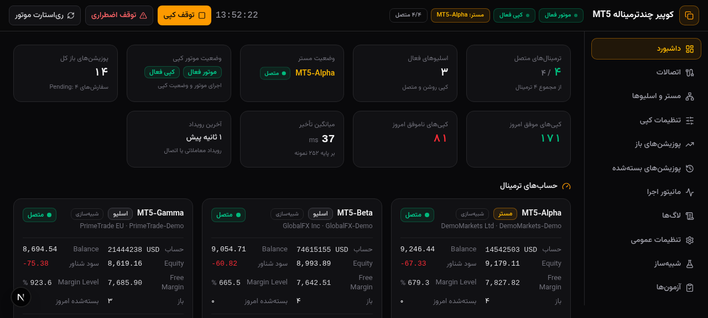

# Multi-MT5 Trade Copier | کوپیر چندترمیناله متاتریدر ۵

نرم‌افزار حرفه‌ای اتصال هم‌زمان به چند ترمینال MetaTrader 5 و کپی فوق‌سریع معاملات از حساب **Master** به همه حساب‌های **Slave** — کاملاً محلی، بدون سرور ابری و بدون نگهداری رمز عبور حساب‌ها.



## ویژگی‌ها

- اتصال هم‌زمان به تعداد دلخواه ترمینال MT5 (هر ترمینال مستقل؛ قطع شدن یکی، بقیه را مختل نمی‌کند)
- معماری Event-Driven با `OnTradeTransaction` برای کمترین تأخیر عملی ممکن
- کپی باز شدن، بستن کامل، Partial Close، تغییر SL/TP و سفارش‌های Pending (۶ نوع)
- حالت‌های حجم: Same / Fixed / Multiplier / Balance Ratio / Risk-Based با رعایت Min/Max/Step بروکر
- نگاشت نماد بین بروکرها (مثل `XAUUSD=GOLD`)
- **جلوگیری قطعی از سفارش تکراری** (دفتر Idempotent با قید یکتا + اسکن کامنت در EA) و بازیابی کامل پس از Restart
- داشبورد لحظه‌ای تیره/فارسی: وضعیت حساب‌ها، پوزیشن‌های باز/بسته، رابطه هر معامله مستر با اسلیوها، مانیتور تأخیر (avg/min/max)، لاگ‌های قابل فیلتر و خروجی CSV
- دو دستور مستقل: **Stop Copying** (فقط توقف کپی) و **Emergency Stop** (سیاست پیش‌فرض: بدون بستن هیچ پوزیشنی)
- امنیت: همه ترافیک روی `127.0.0.1`، بدون رمز عبور، داده‌ها فقط در SQLite محلی

## ساختار مخزن

| مسیر | توضیح |
|---|---|
| `src/` | داشبورد وب (Next.js 16 + TypeScript + Tailwind + shadcn/ui) و موتور مرجع کپی در `src/lib/engine/` |
| `deploy/mql5/MT5CopierEA.mq5` | Expert Advisor پل (نصب در هر ترمینال MT5) |
| `deploy/worker/` | موتور مرکزی ویندوز (Python، فقط کتابخانه استاندارد) + اسکریپت ساخت EXE |
| `deploy/installer/` | اسکریپت‌های ساخت Installer (Inno Setup) و نسخه Portable |
| `deploy/docs/FA/` | راهنمای کامل فارسی (معماری، نصب، اتصال، تنظیمات، تست‌ها، عیب‌یابی) |
| `src/lib/tests/runner.ts` | اجراکننده ۱۷ تست پذیرش با معیارهای واقعی Pass/Fail |

## نصب سریع — مسیر A: ویندوز (کاربر نهایی)

پیش‌نیاز: ویندوز 10/11 x64 و یک بار Python 3.11+ فقط روی سیستم «سازنده» (کاربر نهایی به آن نیاز ندارد):

```bat
git clone https://github.com/realmohamarezaa-netizen/Multi-MT5-Trade-Copier.git
cd Multi-MT5-Trade-Copier\deploy

:: 1) ساخت EXE موتور
cd worker && build_exe.bat

:: 2) ساخت نسخه Portable (یا installer\build_installer.bat برای Setup.exe)
cd ..\installer && build_portable.bat

:: 3) اجرا
MT5Copier-Portable\start-copier.bat
```

سپس در هر ترمینال MT5 فایل `deploy/mql5/MT5CopierEA.mq5` را کامپایل و روی یک چارت بگذارید (راهنما: [`deploy/docs/FA/03-connect-terminals.md`](deploy/docs/FA/03-connect-terminals.md)) و داشبورد را باز کنید: `http://127.0.0.1:8321`

> راهنمای گام‌به‌گام: [`deploy/docs/FA/02-install-guide.md`](deploy/docs/FA/02-install-guide.md)

## نصب سریع — مسیر B: اجرای داشبورد وب (توسعه‌دهنده / حالت نمایشی با شبیه‌ساز)

این مسیر همان نسخه‌ای است که با شبیه‌ساز ترمینال اجرا می‌شود و برای دیدن کل سیستم بدون MT5 مناسب است:

```bash
git clone https://github.com/realmohamarezaa-netizen/Multi-MT5-Trade-Copier.git
cd Multi-MT5-Trade-Copier

# با Bun (پیشنهادی)
cp .env.example .env
bun install
bun run db:push
bun run dev          # http://localhost:3000

# یا با npm
npm install && npx prisma db push && npm run dev
```

پس از اجرا: در نمای «آزمون‌ها» دکمه «اجرای ۱۷ تست پذیرش» را بزنید تا کل خط‌لوله (کپی، بستن، Partial، Idempotency، Restart، همگام‌سازی و ...) به‌صورت خودکار راستی‌آزمایی شود.

## نتایج تست‌های پذیرش (اجرای خودکار در محیط شبیه‌ساز)

۱۷/۱۷ PASS — تأخیر واقعی اندازه‌گیری‌شده خط‌لوله: میانگین ~۳۴ms (min 18 / max 58). فهرست کامل تست‌ها و معیارها: [`deploy/docs/FA/06-tests.md`](deploy/docs/FA/06-tests.md)

## معماری در یک نگاه

```
MT5 #1 (EA) ──┐
MT5 #2 (EA) ──┼── TCP 127.0.0.1:8777 ──▶ موتور مرکزی (Python) ──▶ داشبورد (http://127.0.0.1:8321)
MT5 #N (EA) ──┘            SQLite محلی ◀──
```

جزئیات کامل و مقایسه روش‌ها: [`deploy/docs/FA/01-architecture.md`](deploy/docs/FA/01-architecture.md)

## هشدار و سلب مسئولیت

- این ابزار مستقیماً با حساب‌های معاملاتی کار می‌کند؛ **همیشه اول با حساب Demo تست کنید.**
- تأخیر صفر تضمین نمی‌شود؛ هدف «کمترین تأخیر عملی ممکن با حفظ صحت اجرا» است.
- هیچ داده‌ای از سیستم شما خارج نمی‌شود (فقط `127.0.0.1`).
- استفاده در حساب واقعی با مسئولیت خود شماست.

## License

MIT — [LICENSE](LICENSE)
