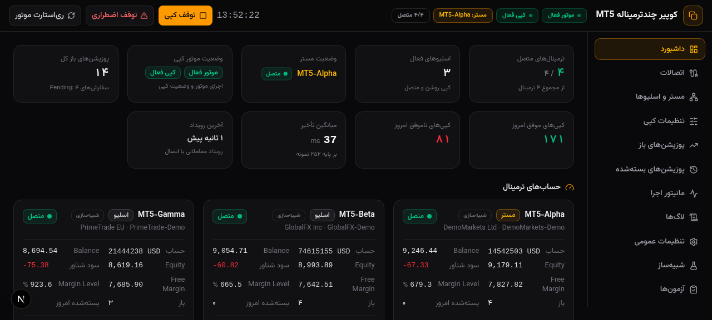

# Multi-MT5 Trade Copier | کوپیر چندترمیناله متاتریدر ۵

نرم‌افزار دسکتاپ حرفه‌ای کپی معاملات از حساب **Master** به همه حساب‌های **Slave** در چند ترمینال MetaTrader 5 — **کاملاً محلی، بدون سرور ابری، بدون Expert Advisor (EA)، بدون فایل MQL5 و بدون مرورگر**. فقط یک بار آیکون برنامه را کلیک کنید: پنجره‌ی خود برنامه با اسکلت گرافیکی باز می‌شود، داشبورد فارسی لود می‌شود و ترمینال‌های MT5 نصب‌شده **به‌صورت خودکار پیدا و متصل** می‌شوند.



## ویژگی‌ها

- **اپ دسکتاپ واقعی**: پس از نصب، با یک کلیک روی آیکون، پنجره‌ی برنامه باز می‌شود (WebView2 بومی ویندوز) — نه مرورگر، نه پنجره‌ی سیاه کنسول. هنگام استارت، اسکلت گرافیکی «در حال بارگذاری» نمایش داده می‌شود و بعد خودکار به داشبورد تبدیل می‌شود.
- **بدون EA**: اتصال هر ترمینال با API رسمی `MetaTrader5` پایتون انجام می‌شود (IPC مستقیم به `terminal64.exe`). داخل ترمینال‌ها **هیچ چیزی نصب یا اجرا نمی‌شود**؛ فقط دکمه‌ی Algo Trading روشن باشد.
- **تشخیص خودکار ترمینال‌ها**: مسیرهای نصب، رجیستری و ترمینال‌های در حال اجرا اسکن می‌شوند؛ با زدن دکمه‌ی «اسکن» همه‌ی ترمینال‌های MT5 موجود روی ویندوز در داشبورد ظاهر می‌شوند و اتصال خودکار برقرار می‌شود.
- کپی باز شدن، بستن کامل، Partial Close، تغییر SL/TP و سفارش‌های Pending (۶ نوع) با تأخیر عملی پایین (پولینگ ۳۵۰ms + تفاضل‌گیری اسنپ‌شات)
- حالت‌های حجم: Same / Fixed / Multiplier / Balance Ratio / Risk-Based با رعایت Min/Max/Step بروکر
- نگاشت نماد بین بروکرها (مثل `XAUUSD=GOLD`) با مقیاس‌دهی متناسب قیمت‌های SL/TP و Pending
- **جلوگیری قطعی از سفارش تکراری** (قید UNIQUE در دیتابیس + تگ `MC:open:<ticket>` در کامنت) و بازیابی کامل پس از Restart؛ مانیتور پر شدن هر دو Pending
- نگه‌دارنده‌ی پل هر ترمینال (Bridge Supervisor) با ری‌استارت خودکار و Backoff؛ قطع شدن یک ترمینال بقیه را مختل نمی‌کند
- داشبورد لحظه‌ای تیره/فارسی: وضعیت حساب‌ها، پوزیشن‌های باز/بسته، رابطه هر معامله‌ی مستر با اسلیوها، مانیتور تأخیر (avg/min/max)، لاگ‌های قابل فیلتر و خروجی CSV
- دو دستور مستقل: **Stop Copying** (فقط توقف کپی) و **Emergency Stop** (سیاست پیش‌فرض: بدون بستن هیچ پوزیشنی)
- امنیت: همه‌ی ترافیک روی `127.0.0.1`؛ اینترنت فقط برای اتصال عادی خود ترمینال‌ها به بروکر استفاده می‌شود و هیچ داده‌ای از سیستم شما خارج نمی‌شود

## دانلود و نصب (کاربر نهایی — ویندوز 10/11 x64)

به صفحه‌ی [Releases](https://github.com/realmohamarezaa-netizen/Multi-MT5-Trade-Copier/releases/latest) بروید و یکی از این فایل‌ها را دانلود کنید:

| فایل | مناسب برای |
|---|---|
| `MT5Copier-Setup-Windows-x64.zip` | **پیشنهادی** — نصب کلاسیک؛ فایل نصب EXE داخل ZIP است (برای دانلود راحت). ZIP را باز کنید و `MT5Copier-Setup.exe` را اجرا کنید |
| `MT5Copier-Setup.exe` | نصب کلاسیک (همان فایل نصب، بدون ZIP) |
| `MT5Copier-Windows-x64.zip` | نسخه‌ی Portable بدون نصب |

نصب کلاسیک فقط Next → Next است: آیکون **MT5 Copier** روی دسکتاپ و منوی استارت ساخته می‌شود، برنامه با باز شدن ویندوز می‌تواند خودکار اجرا شود (اختیاری) و با Uninstall هم به‌طور تمیز حذف می‌شود.

> راهنمای گام‌به‌گام تصویری: [`deploy/INSTALL-FA.md`](deploy/INSTALL-FA.md) و [`deploy/FIRST-TIME-FA.txt`](deploy/FIRST-TIME-FA.txt)

## استفاده در ۴ قدم

1. **نصب**: ZIP دانلودی را باز کنید، `MT5Copier-Setup.exe` را اجرا و نصب را کامل کنید.
2. **اجرا**: روی آیکون **MT5 Copier** در دسکتاپ دابل‌کلیک کنید؛ پنجره‌ی برنامه با اسکلت لودینگ باز می‌شود و چند لحظه بعد داشبورد فارسی ظاهر می‌شود.
3. **اتصال ترمینال‌ها**: ترمینال‌های MT5 را باز کنید و دکمه‌ی Algo Trading هر کدام را روشن کنید؛ در داشبورد دکمه‌ی «اسکن ترمینال‌ها» را بزنید — همه‌ی ترمینال‌های نصب‌شده خودکار پیدا و متصل می‌شوند (در صورت نیاز، لاگین/رمز/سرور همان حساب را یک بار ذخیره کنید).
4. **کپی**: در داشبورد یک حساب را Master و بقیه را Slave کنید، حالت حجم و نگاشت نماد را تنظیم کنید — از این به بعد هر معامله‌ی مستر روی همه‌ی اسلیوها کپی می‌شود.

## ساختار مخزن

| مسیر | توضیح |
|---|---|
| `deploy/worker/copier_engine.py` | موتور مرکزی + اپ دسکتاپ: پنجره‌ی بومی، اسکلت لودینگ، تشخیص خودکار ترمینال، پل‌های `MetaTrader5` و داشبورد `http://127.0.0.1:8321` |
| `deploy/worker/ui/` | داشبورد از پیش ساخته‌شده (خروجی Next.js) که داخل EXE امبد می‌شود |
| `deploy/worker/copier_engine.spec` | اسکریپت PyInstaller (ONEFILE + WINDOWED با امبد UI و MetaTrader5/pywebview) |
| `deploy/installer/` | ساخت Installer کلاسیک (Inno Setup) و نسخه‌ی Portable |
| `deploy/docs/FA/` | راهنمای کامل فارسی (معماری، نصب، اتصال، تنظیمات، تست‌ها، عیب‌یابی) |
| `.github/workflows/build-windows.yml` | CI: با هر تگ `v*`، فایل نصب و نسخه‌ی Portable ساخته و به Releases پیوست می‌شود |
| `src/` | سورس داشبورد (Next.js 16 + TypeScript + Tailwind + shadcn/ui) برای توسعه‌دهندگان |

## اجرای داشبورد در حالت توسعه (توسعه‌دهنده / نمایشی با شبیه‌ساز)

```bash
git clone https://github.com/realmohamarezaa-netizen/Multi-MT5-Trade-Copier.git
cd Multi-MT5-Trade-Copier

# با Bun (پیشنهادی)
cp .env.example .env
bun install
bun run db:push
bun run dev          # http://localhost:3000

# یا با npm
npm install && npx prisma db push && npm run dev
```

در نسخه‌ی ویندوز، حالت نمایشی کامل بدون MT5 با متغیر محیطی `COPIER_DEMO=1` فعال می‌شود (ترمینال‌های شبیه‌سازی‌شده) و برای ساخت EXE روی ویندوز: `deploy/worker/build_exe.bat` و سپس `deploy/installer/build_installer.bat`.

## معماری در یک نگاه

```
┌─ MT5CopierEngine.exe (اپ دسکتاپ، یک فایل) ─────────────────────────┐
│  پنجره‌ی بومی WebView2: اسکلت لودینگ → داشبورد فارسی               │
│  HTTP 127.0.0.1:8321 (داشبورد + API)   SQLite محلی (db\)            │
│                                                                     │
│  Bridge #1 ── MetaTrader5 API ──▶ terminal64.exe (Master)           │
│  Bridge #2 ── MetaTrader5 API ──▶ terminal64.exe (Slave)            │
│  Bridge #N ── MetaTrader5 API ──▶ terminal64.exe (Slave)            │
│  (هر پل یک ساب‌پروسه‌ی همان EXE است؛ بدون EA، بدون MQL5)            │
└─────────────────────────────────────────────────────────────────────┘
```

جزئیات کامل و مقایسه روش‌ها: [`deploy/docs/FA/01-architecture.md`](deploy/docs/FA/01-architecture.md)

## هشدار و سلب مسئولیت

- این ابزار مستقیماً با حساب‌های معاملاتی کار می‌کند؛ **همیشه اول با حساب Demo تست کنید.**
- تأخیر صفر تضمین نمی‌شود؛ هدف «کمترین تأخیر عملی ممکن با حفظ صحت اجرا» است.
- هیچ داده‌ای از سیستم شما خارج نمی‌شود (فقط `127.0.0.1` + اتصال عادی ترمینال‌ها به بروکر).
- استفاده در حساب واقعی با مسئولیت خود شماست.

## License

MIT — [LICENSE](LICENSE)
